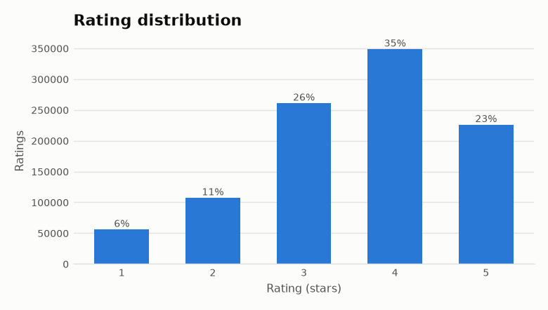
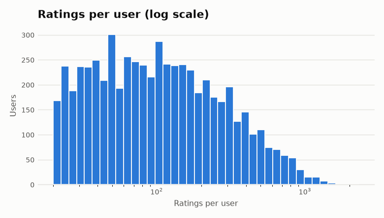
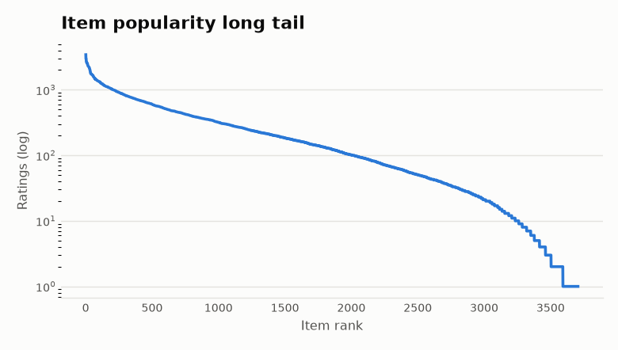
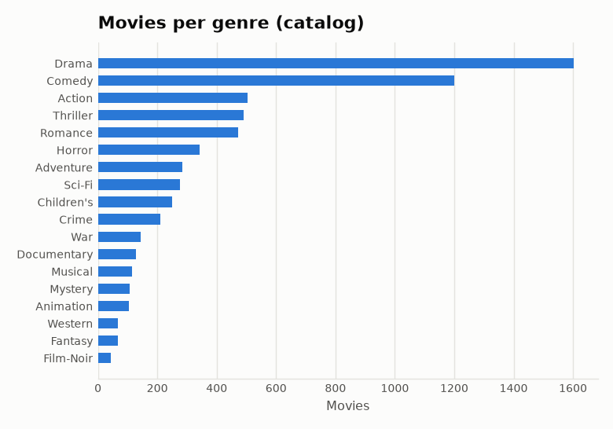
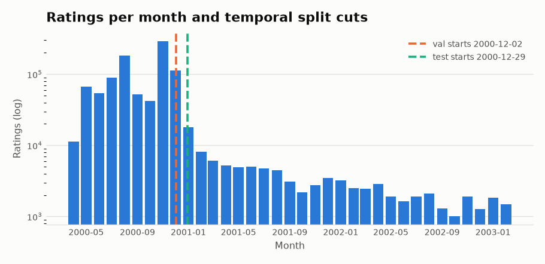

# EDA hesabatı — MovieLens 1M

Bu fayl `recsys preprocess` tərəfindən avtomatik yaradılır. Bütün rəqəmlər real datadan hesablanıb.

## Əsas göstəricilər

| Göstərici | Dəyər |
|---|---|
| İstifadəçi | 6,040 |
| Kataloqdakı film | 3,883 |
| Reytinqi olan film | 3,706 |
| Reytinqsiz film (real cold item) | 177 |
| Reytinq | 1,000,209 |
| Sparsity | 95.7353% |
| Orta reytinq | 3.582 (std 1.117) |
| Reytinq ≥ 4 payı | 57.5% |
| İstifadəçi başına reytinq (min / median / max) | 20 / 96 / 2314 |
| Film başına reytinq (min / median / max) | 1 / 124 / 3428 |
| Populyarlıq Gini | 0.650 |
| Ən populyar 1% filmin reytinq payı | 8.7% |
| Tag-i olan film (ML-32M) | 2,550 |
| Zaman aralığı | 2000-04-25 — 2003-02-28 |

## Validasiya

Daxil olan reytinq: 1,000,209; qalan: 1,000,209.

| Qayda | Silinən sətir |
|---|---|
| missing_values | 0 |
| non_integer_rating | 0 |
| rating_out_of_range | 0 |
| timestamp_out_of_range | 0 |
| unknown_item | 0 |
| unknown_user | 0 |
| duplicate_user_item | 0 |

## Split (əsas: qlobal temporal)

| Hissə | Reytinq | İstifadəçi | Warm istifadəçi | Cold istifadəçi | Yeni film | Tarix |
|---|---|---|---|---|---|---|
| train | 800,164 | 5,400 | — | — | — | 2000-04-25 — 2000-12-02 |
| val | 100,024 | 1,134 | 523 | 611 | 16 | 2000-12-02 — 2000-12-29 |
| test | 100,021 | 1,209 | 1180 | 29 | 28 | 2000-12-29 — 2003-02-28 |

Qeyd: MovieLens 1M reytinqlərinin böyük hissəsi 2000-ci ilə aiddir. Qlobal zaman kəsiyi validation dövründə çoxlu yeni (cold) istifadəçi yaradır (test dövründə azdır). Onlar ayrıca cold-start protokolu ilə qiymətləndirilir.

## Qrafiklər

